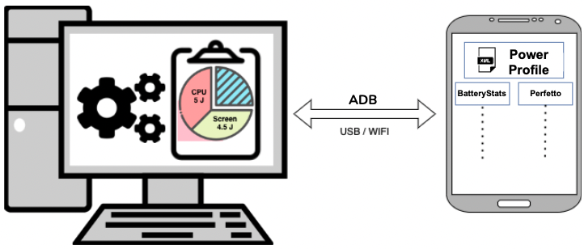

# PyAnaDroid
[](https://www.python.org/)
[](https://badge.fury.io/py/anadroid)
[](https://pypi.python.org/pypi/anadroid)
[](https://pypi.python.org/pypi/anadroid)
[](https://doi.org/10.5281/zenodo.8242001)


PyAnaDroid is a tool capable of automating the process of analyzing and benchmarking Android applications' energy consumption, using state-of-the-art energy analysis tools. PyAnaDroid can be configured to use different energy profilers and test frameworks in its execution pipeline, being able to perform automatic instrumentation and building of application source code. It can be used to perform both white-box and black-box testing.


## Documentation

https://sanadlab.org/pyanadroid/

The documentation is built from `docs_src/` by the `Docs` workflow.

## Video Demo

https://www.youtube.com/watch?v=7AV3nrh4Qc8

## Use cases
- Application Benchmarking: Replicating test work/procedures on different applications to carry out comparative studies of energy consumption.
- Detection of energy hotspots in application code;
- Detection of energy-greedy coding practices;
- Calibration of energy consumption prediction models;
- Many others.  

## Supported Test Frameworks
- JUnit-based frameworks (Robotium, Espresso, JUnit);
- Application UI/Exerciser Monkey;
- Monkeyrunner;
- DroidBot;
- App Crawler;
- RERAN;
- Monkey++ (soon).

## Supported energy profilers:
- Trepn Profiler;
- E-Manafa (default);
- GreenScaler;
- Monsoon (soon);
- Petra (soon).


# Workflow

By default, PyAnaDroid is configured to perform white-box testing of applications, instrumenting its code (Java and/or Kotlin), in order to collect tracing of the methods invoked during application execution and estimate the energy consumed by these. After the instrumentation phase, a project is created in the original directory, which is a copy of it, with the code and build scripts already instrumented. Then, the source code and apk are built from the sources of the instrumented project (both debug and release builds are supported), and the application is installed on the device. After installation, the energy profiler is enabled and the application tests are executed. At the end of the process, the monitoring process is stopped and its results collected, and the application is uninstalled.



# Installation:

Requirements: Python 3.9 or later, the Android SDK (`ANDROID_HOME` must be set, with `adb` in the `PATH`) and a JDK. See `install.md` and `requirements.md` for details.

## Using python-pip
```
$ pip install anadroid
```

## From source

```
$ git clone --recurse-submodules https://github.com/sanadlab/pyanadroid.git
$ cd pyanadroid
$ pip install -e .
```

The package is in `src/anadroid`. The tests are in `tests/`: `python -m pytest` runs the unit tests (no device needed), and `python -m pytest tests/device` runs the tests that need a connected device.


# Examples


## Plug-and-play execution

```
$ pyanadroid -h
usage: pyanadroid [-h]
                  [-t {Monkey,Monkeyrunner,JUnit,RERAN,Espresso,Robotium,Crawler,Droidbot,Custom,Other,None}]
                  [-p {Trepn,GreenScaler,Petra,Monsoon,E-manafa,None}] [-b {Release,Debug,Custom,}]
                  [-i {JInst,Hunter,Manifest,None}]
                  [-it {MethodOriented,TestOriented,('ActivityOriented',),AnnotationOriented,ManifestOriented,None}]
                  [-pa {Old Anadroid Analyzer,Manafa Analyzer}] [-d DIRETORY] [-dev DEVICE] [-bo] [-record]
                  [-run] [-rb] [-ri] [-ja] [-sa] [-sc {USB,WIFI}] [-ds DEVICE_SERIAL] [-td TESTS_DIR]
                  [-n PACKAGE_NAMES [PACKAGE_NAMES ...]]
                  [-apk APPLICATION_PACKAGES [APPLICATION_PACKAGES ...]] [-rec] [-cmd COMMAND] [-nt N_TIMES]
                  [-bd {AnadroidBuilder,Buildroid}]
                  [-sat {scc,lint,pmd,daap,adoctor,ecoandroid,detekt,spotbugs,infer,chimera,xalint} [{scc,lint,pmd,daap,adoctor,ecoandroid,detekt,spotbugs,infer,chimera,xalint} ...]]
                  [-j JOBS] [--config CONFIG] [--workdir WORKDIR] [--setup] [-v]

options:
  -h, --help            show this help message and exit
  -t {Monkey,Monkeyrunner,JUnit,RERAN,Espresso,Robotium,Crawler,Droidbot,Custom,Other,None}, --testingframework {Monkey,Monkeyrunner,JUnit,RERAN,Espresso,Robotium,Crawler,Droidbot,Custom,Other,None}
                        testing framework to exercise app(s)
  -p {Trepn,GreenScaler,Petra,Monsoon,E-manafa,None}, --profiler {Trepn,GreenScaler,Petra,Monsoon,E-manafa,None}
                        energy profiler
  -b {Release,Debug,Custom,}, --buildtype {Release,Debug,Custom,}
                        app build type
  -i {JInst,Hunter,Manifest,None}, --instrumenter {JInst,Hunter,Manifest,None}
                        Source code instrumenter
  -it {MethodOriented,TestOriented,('ActivityOriented',),AnnotationOriented,ManifestOriented,None}, --instrumentationtype {MethodOriented,TestOriented,('ActivityOriented',),AnnotationOriented,ManifestOriented,None}
                        instrumentation type
  -pa {Old Anadroid Analyzer,Manafa Analyzer}, --post_execution_analyzers {Old Anadroid Analyzer,Manafa Analyzer}
                        results analyzer
  -d DIRETORY, --diretory DIRETORY
                        app(s)' folder
  -dev DEVICE, --device DEVICE
                        device <Action>. performs device class commands
  -bo, --buildonly      just build apps
  -record, --record     record test
  -run, --run_only      run only (skip build and instrumentation phase)
  -rb, --rebuild        rebuild apps
  -ri, --reinstrument   reinstrument app
  -ja, --justanalyze    just analyze apps
  -sa, --staticanalyze  statically analyze apps
  -sc {USB,WIFI}, --setconnection {USB,WIFI}
                        set connection to device and exit
  -ds DEVICE_SERIAL, --device_serial DEVICE_SERIAL
                        device serial id
  -td TESTS_DIR, --tests_dir TESTS_DIR
                        tests directory
  -n PACKAGE_NAMES [PACKAGE_NAMES ...], --package_names PACKAGE_NAMES [PACKAGE_NAMES ...]
                        package(s) of already installed apps
  -apk APPLICATION_PACKAGES [APPLICATION_PACKAGES ...], --application_packages APPLICATION_PACKAGES [APPLICATION_PACKAGES ...]
                        path of apk(s) to process
  -rec, --recover       recover progress of the previous run
  -cmd COMMAND, --command COMMAND
                        test command
  -nt N_TIMES, --n_times N_TIMES
                        times to repeat test (overrides config)
  -bd {AnadroidBuilder,Buildroid}, --builder {AnadroidBuilder,Buildroid}
                        builder to use
  -sat {scc,lint,pmd,daap,adoctor,ecoandroid,detekt,spotbugs,infer,chimera,xalint} [{scc,lint,pmd,daap,adoctor,ecoandroid,detekt,spotbugs,infer,chimera,xalint} ...], --static_analyzers {scc,lint,pmd,daap,adoctor,ecoandroid,detekt,spotbugs,infer,chimera,xalint} [{scc,lint,pmd,daap,adoctor,ecoandroid,detekt,spotbugs,infer,chimera,xalint} ...]
                        static analyzers to run before the build
  -j JOBS, --jobs JOBS  number of projects to analyze at the same time (with -sa)
  --config CONFIG       general config file (JSON) to use in place of the default file
  --workdir WORKDIR     directory for the logs and the results (default: current directory)
  --setup               download the external tools (jars) and exit
  -v, --verbose         show debug messages (commands and their results)
```


## Static analysis

Use `-sa` to run static analyzers on the project sources. Select the analyzers with `-sat` and the number of projects to analyze at the same time with `-j`:

```
$ pyanadroid -d <projects_dir> -sa -sat lint pmd detekt -j 4
```

Available analyzers: `scc` (default), `lint`, `pmd`, `daap`, `adoctor`, `ecoandroid`, `detekt`, `spotbugs`, `infer`, `chimera`, `xalint`.

## External tools

PyAnaDroid runs external tools (JInst, DAAP, aDoctor and others). The list, with download URLs and checksums, is in `src/anadroid/resources/tools.json`. To download them to `~/.cache/pyanadroid/tools`:

```
$ pyanadroid --setup
```

A tool is searched in this order: the environment variable `PYANADROID_<NAME>` (e.g. `PYANADROID_JINST=/path/jInst.jar`), the downloaded tools, and the files bundled in the package. Set `PYANADROID_TOOLS_DIR` to use a different download directory.

PMD, SpotBugs, Detekt and Infer are not downloaded. Install them and put them in the `PATH` (or set `PMD_HOME` and `SPOTBUGS_HOME`). The `Dockerfile` has an environment with SpotBugs, Detekt and Infer.

## Configuration and working directory

The general configuration (number of tests for each app, build retries) is a JSON file. PyAnaDroid uses the first file that exists in this order: the file given with `--config` (or `PYANADROID_CONFIG`), `general_config.json` in the current directory, `~/.config/pyanadroid/general_config.json`, and the default file of the package (`src/anadroid/resources/config/general_config.json`).

By default, the logs (`logs/`) and the results (`anadroid_results/`) are written in the current directory. Use `--workdir <dir>` to write them in a different directory.

## Logs

Each run writes a log file in `logs/`. The path is shown at the start of the run. The file has all messages, which includes the debug messages (each command and its result, and the Gradle output of failed builds). Use `-v` to show the debug messages on the console too.

## JDK selection

PyAnaDroid selects the JDK (8, 11, 17 or 21) that matches the Gradle version of each project. It looks for installed JDKs in the usual locations (SDKMAN, Homebrew, `/Library/Java/JavaVirtualMachines`, `/usr/lib/jvm`). To use a specific JDK, set `JAVA_HOME_<version>` (e.g. `JAVA_HOME_17=/path/to/jdk17`).

## From Python code


### Execute a simple Monkey test over an application

By default, PyAnaDroid uses the E-Manafa profiler to estimate energy consumption. The Monkey test (or any other test with other supported testing framework) and its parameters can be configured by modifying the .cfg present in the `src/anadroid/resources/testingFrameworks/<framework>` directory. The results are stored in the `anadroid_results/<app_id>/<app_version>` directory.

```
from anadroid.Anadroid import AnaDroid
from anadroid.Types import TESTING_FRAMEWORK

folder_of_app = "demoProjects/SampleApp"
anadroid = AnaDroid(folder_of_app, testing_framework=TESTING_FRAMEWORK.MONKEY)
anadroid.default_workflow()
```


## Working Examples


### Example 1 - Using DroidBot to automatically test an Android project(s) and monitor its energy consumption (from command-line)

```
$ pyanadroid -d <projects_dir> -t Droidbot
```

### Example 2 - Perform a custom test (e.g touch app screen)

```
$ pyanadroid -d <projects_dir> -t Custom -cmd 'adb shell input touchscreen tap 500 500'
```

###  Example 3 - Extend PyAnaDroid workflow to perform custom actions

#### 1) Create a new subclass of the AnaDroid class and implement and override the default_workflow method 

```
from anadroid.Anadroid import AnaDroid

class MyCustomAnaDroidWorkflow(AnaDroid):

  def default_workflow(self):
    # example: reboot device after each test suite
    super().default_workflow()
    self.device.reboot()

```

#### 2) Invoke the new custom workflow

```
custom_wkflow = MyCustomAnaDroidWorkflow("<projects_dir>")
custom_wkflow.default_workflow()

```

###  Example 4 - Skip instrumentation and building phase and perform black-box analysis only over the apks.
Note: the process will still be monitored using the profiler but the performance metrics will only be given at the test level (e.g. the energy consumption of each test execution).

```
$ pyanadroid -d <projects_dir> -run -t Custom -cmd 'adb shell input touchscreen tap 500 500'
```

PyAnaDroid produces a large amount of results from the analysis it does on its execution blocks. These results are stored in the form of files in specific directories. For each execution of a certain version of a certain app, a subdirectory is created in the directory anadroid_results/\<app-name\>--\<app-package\>/\<app-version\> where all the results of the analyzes carried out on the applications will appear. For each execution of a test framework on an application, a subdirectory \<testing-framework\>\<instrumentation-type\>\<timestamp\> is created inside the previous directory and that contains the results related to that execution. The result files are as follows:
- tests_index.json: contains the list of files associated with each test run, identified by test id.
- test_\<test-id\>.logcat: contains device logs captured during test execution;
- test_\<test-id\>_logresume.json: contains a summary made from the analysis of the logs contained in the file test_<test-id>.logcat. It has metrics such as the number of exceptions thrown, fatal or error log messages, etc.
- device.json: contains the specs of the device where the tests were conducted (brand, model, ram, cpu cores, serial nr, etc)
- manafa_resume_<test_id>.json: contains test-level performance metrics reported by E-Manafa (if used);
- functions_\<timestamp\>.json: contains performance metrics for each of the executed functions/methods of the app in a certain test.
- trace-\<timestamp\>-\<timestamp\>.systrace: contains the cpu frequency changes logged during a certain test id;
